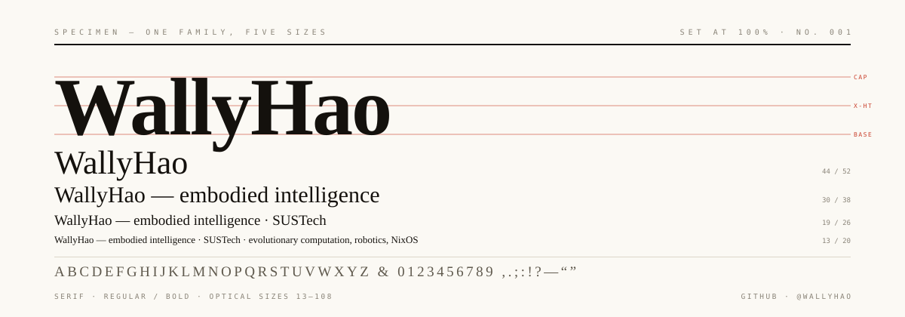

  

### colophon

I'm WallyHao, a third-year undergraduate in the Department of Computer Science and Engineering at the Southern University of Science and Technology (SUSTech). I am a former member of the SUSTech Robocon ARES algorithm team.

My engineering interests lie in embodied intelligence. I have worked with vision-language-action models, SLAM, and perception, and have recently begun exploring training and simulation for legged robots. My research focuses on the computational complexity analysis of evolutionary algorithms.

I appreciate small, well-designed open-source projects and build tools that are clear to understand, comfortable to use, and practical to maintain.

### competition

With SUSTech Robocon ARES, I received a national second prize in the main competition in both the 2025 and 2026 Robocon seasons.

### selected work

- [**Folio**](https://github.com/WallyHao/folio-nixos-config) — a modular NixOS and Home Manager environment for daily use, training, and deployment.
- [**AlignGrasp**](https://github.com/WallyHao/align-grasp) — millimeter-level alignment perception and autonomous grasping for a ROS 2 robot.
- [**RoboMind**](https://github.com/WallyHao/robo-mind) — embodied robot control combining language-model planning, visual perception, and simulation in a dual-process architecture.

### tools & interests

Embodied intelligence · VLA · SLAM · legged robots · evolutionary computation · ROS 2 · Python · NixOS

### sharing

I share technical videos on Bilibili as **哇哩唔嗷大福喵**.

Specimen adapted from [Type Specimen](https://github.com/beydemirfurkan/awesome-github-profile/tree/main/templates/11-swiss-brutalist/type-specimen), by Awesome GitHub Profile contributors. See [license](LICENSE.template).
